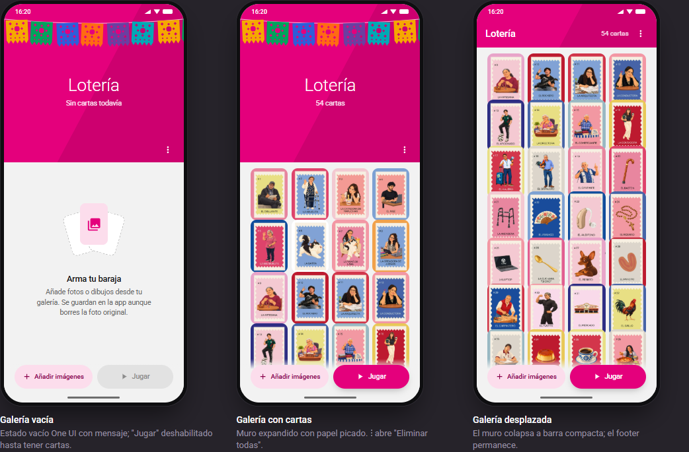
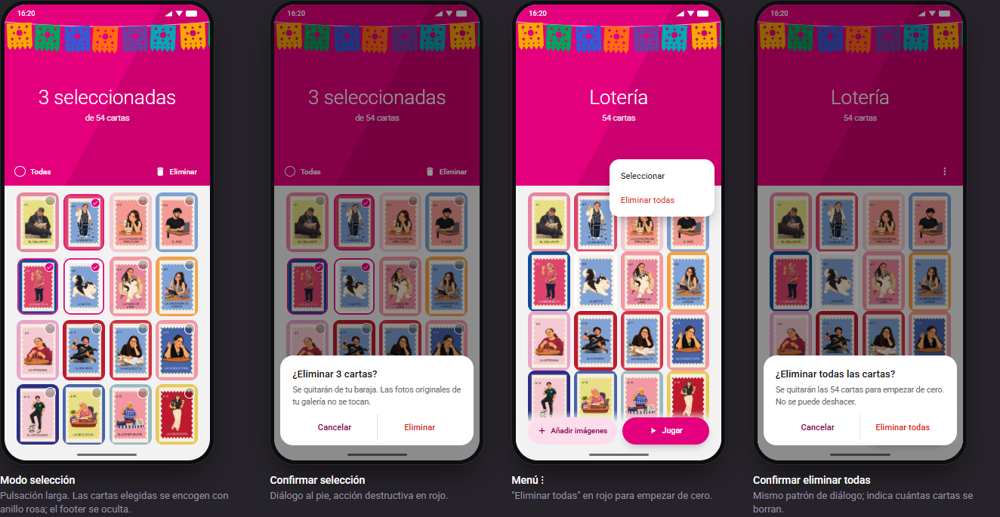
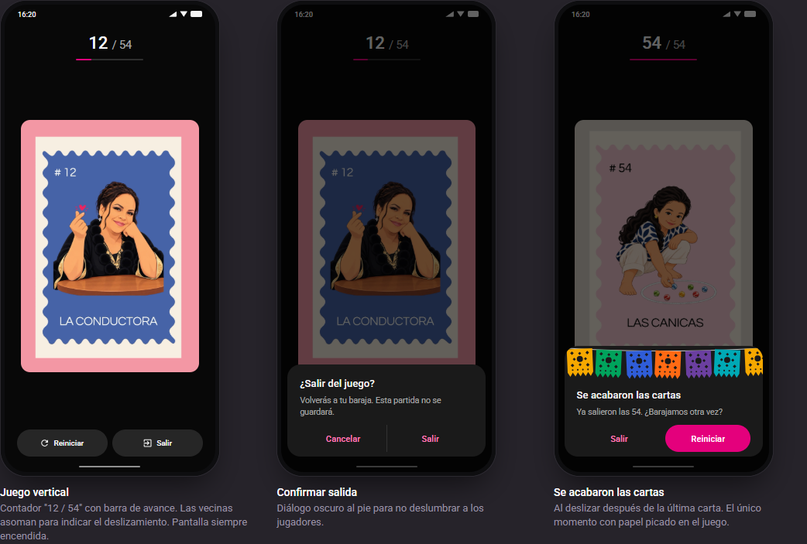
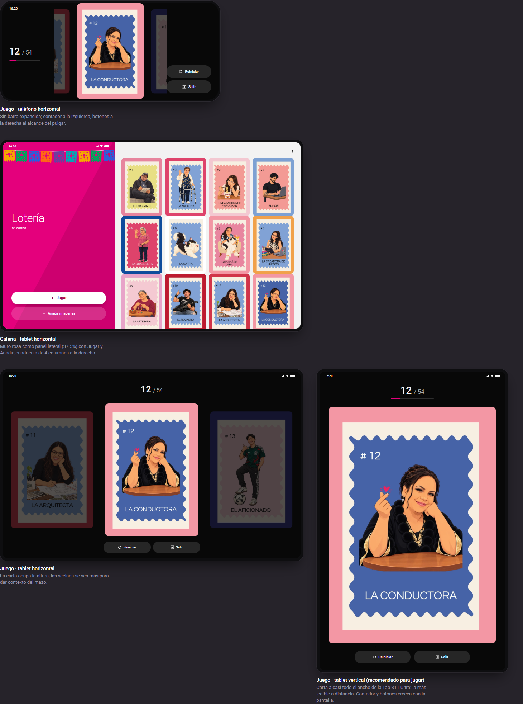
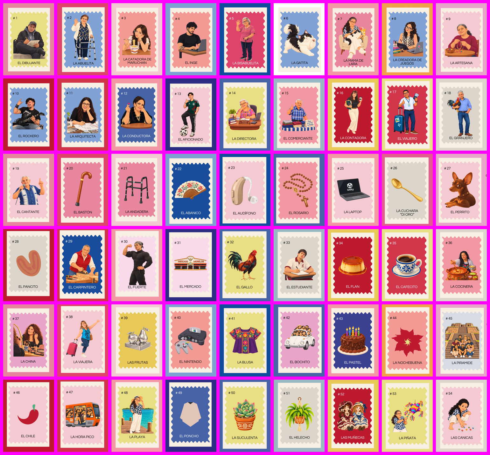
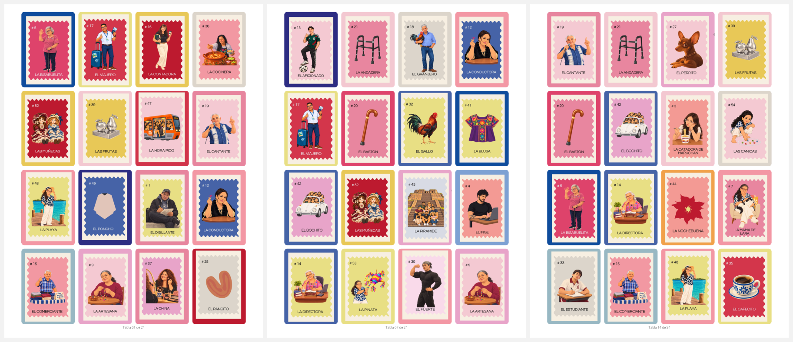

# Lotería 🎴

Presentador digital de **cartas de lotería personalizadas** para Android, más los **24 tableros imprimibles** que lo acompañan.

El cantor carga sus propias imágenes en la app, la app las baraja y las muestra en grande una por una, y cada jugador marca su tabla impresa. Está diseñada para un **Galaxy S26 Ultra** y una **Galaxy Tab S11 Ultra**, sobre la estructura de Samsung **One UI** con un toque de fiesta mexicana: muro rosa mexicano y papel picado.



---

## Contenido del repositorio

| Carpeta | Qué hay |
|---|---|
| [`android/`](android) | Proyecto Android completo (Kotlin + Jetpack Compose, Material 3, una sola Activity) |
| [`cards/normalized/`](cards/normalized) | Las 54 cartas del MVP, normalizadas a 1500 × 2125 px y sin bordes negros |
| [`tools/cards_tool.py`](tools/cards_tool.py) | Script que detecta y recorta las cartas desde capturas de pantalla y las normaliza |
| [`tools/tableros/`](tools/tableros) | Generador de los 24 tableros 4×4 en PDF tamaño Carta, más los PDF ya generados |
| [`design/comps/`](design/comps) | Comps en HTML: v1 (galería y juego) y v2 (juegos, editor de cartas, tableros) |
| [`docs/`](docs) | Contexto del producto, sistema de diseño, guía de impresión e imágenes |

## La app

### Juegos (barajas)
- La pantalla de inicio lista los **juegos**. Cada uno tiene sus propias cartas y tableros, número de tableros (24 por defecto) y tamaño (**4×4** o **3×3**).
- Dentro de un juego, la barra inferior lleva a **Cartas**, **Tableros** y **Ajustes**. El muro rosa con papel picado muestra el nombre y los números del juego.
- **Pulsación larga** en una carta activa la selección múltiple ("Todas", "Eliminar"). Tocar una carta la abre en el editor.
- **Mínimo de cartas:** se calcula con el mismo generador de tableros (tableros distintos, reparto parejo y dos tableros comparten como máximo la mitad de sus casillas). Por ejemplo, 24 tableros 4×4 necesitan **36 cartas**. Si faltan, un aviso ámbar indica cuántas, y "Jugar" y "Exportar" lo recuerdan.
- **Rebarajar:** al **añadir o eliminar** cartas, o al cambiar el número o tamaño de tableros, la app avisa que los tableros se generarán de nuevo al azar. Editar el diseño de una carta **no** rebaraja.
- **Tableros:** cuadrícula de tablas. Al tocar una se abre el visor, donde se desliza entre tablas y se pellizca para acercar.
- **Exportar PDF** (con Compartir): tableros, cartas (9 por hoja con línea de corte) o ambos; **casa Carta**, **casa A4** o **imprenta Carta** con 3 mm de rebase.
- **Migración:** las cartas de la versión anterior pasan tal cual a "Mi primera lotería". Si son las 54 originales (se reconocen por su huella SHA-256), conserva los **24 tableros ya impresos**.

### Editor de cartas
- "Crear cartas" abre el Photo Picker (una o varias imágenes). Con varias trabaja en **cola** ("Carta 3 de 20", Anterior y Siguiente) y guarda todas juntas.
- Cada imagen entra en el **molde de las cartas originales**: marco exterior, marco interior crema y zigzag ondulado. Los colores salen solos de la **paleta de la imagen**: exterior con el dominante, zigzag con un secundario suavizado, y número y leyenda en blanco o negro según el contraste.
- **Pellizcar** cambia el tamaño y **arrastrar** mueve la imagen dentro del zigzag. Una **guía rosa** aparece y la imagen se ajusta cuando queda centrada en X o en Y.
- Cada elemento se puede recolorear con la paleta de la imagen, los colores de Lotería o un **selector libre** (rueda, brillo y HEX). La leyenda y el número no cambian de tamaño ni de color.
- **Leyenda:** mayúsculas automáticas, centrada, hasta **2 líneas**, con tamaño que se ajusta solo (tipografía Lexend).
- Si la imagen no tiene transparencia, un aviso recomienda usar **PNG con fondo transparente**.
- En **tablet u horizontal**, la carta va a la izquierda y las capas (Marco exterior, Marco interior, Zigzag) a la derecha.
### Juego
- Baraja **Fisher–Yates** y `HorizontalPager` con **una carta por gesto**, para que un deslizamiento rápido nunca se salte una carta.
- Muestra la imagen completa (`ContentScale.Fit`) sobre fondo oscuro, con la **pantalla siempre encendida**.
- Contador **"12 / 54"** con barra de avance.
- **Reiniciar** vuelve a barajar y regresa a la primera carta. **Salir** pide confirmación.
- Al pasar de la última carta aparece **"Se acabaron las cartas"** con papel picado.
- El orden del mazo y la carta actual **sobreviven a rotaciones y al cierre del proceso** (`ViewModel` + `SavedStateHandle`).

| Selección | Juego | Tablet |
|---|---|---|
|  |  |  |

### Arquitectura

```
android/app/src/main/java/com/diegoibarra/loteria/
├── MainActivity.kt          # Una sola Activity; rutas Inicio · Juego · Editor · Visor · Jugar
├── LoteriaViewModel.kt      # Navegación, selección, mínimo de cartas, mazo (SavedStateHandle), exportar
├── EditorViewModel.kt       # Cola de cartas en edición, imagen actual, aviso de PNG
├── data/
│   ├── Models.kt            # Game, CardSpec, CardDesign (JSON con kotlinx.serialization)
│   ├── GameRepository.kt    # games.json + games/<juego>/{src,render}; migración desde la v1
│   └── Boards.kt            # Reparto balanceado de tableros y cálculo del mínimo de cartas
├── render/
│   ├── CardTemplate.kt      # Molde de la carta, leyenda, número, colores con Palette
│   └── PdfExporter.kt       # PDF de tableros y cartas (casa Carta/A4, imprenta con rebase)
└── ui/
    ├── HomeScreen.kt        # Lista de juegos y "Nuevo juego"
    ├── GameDetailScreen.kt  # Cartas · Tableros · Ajustes, selección, avisos, exportar
    ├── EditorScreen.kt      # Editor (teléfono: vista previa y panel; tablet: dos paneles)
    ├── ColorPicker.kt       # Rueda, brillo y HEX
    ├── BoardViewerScreen.kt # Visor de tableros con zoom
    ├── GameScreen.kt        # Jugar: contador, pager, diálogos de salir y de fin
    ├── Common.kt            # Muro con scroll, barra inferior, aviso ámbar, tablero, carta con número
    ├── Components.kt        # Papel picado, botones píldora, diálogo One UI al pie
    └── theme/Theme.kt       # Colores y tema Material 3
```

Las pruebas unitarias de `Boards` (`./gradlew testDebugUnitTest`) verifican tableros distintos, el máximo de coincidencias, el reparto parejo y el mínimo calculado.
### Versiones

Son las versiones estables más recientes compatibles con **Android Studio Rabbit 2 (2026.2.2)** a la fecha del proyecto:

| Componente | Versión |
|---|---|
| Android Gradle Plugin | 9.5.2 |
| Gradle | 9.8.2 |
| Kotlin | 2.4.21 |
| Compose BOM | 2026.09.00 |
| Coil | 3.6.3 |
| kotlinx.serialization | 1.13.0 |
| Palette | 1.1.0 |
| compileSdk / targetSdk / minSdk | 37 / 37 / 26 |
| JDK | 17+ (se usa el JBR de Android Studio) |

### Compilar e instalar

**Con Android Studio:** usa *File › Open*, elige la carpeta `android/` y pulsa ▶ *Run*.

**Desde la terminal** (Windows PowerShell), sin abrir Android Studio:

```powershell
cd android
$env:JAVA_HOME = "C:\Program Files\Android\Android Studio\jbr"
.\gradlew.bat assembleDebug    # APK en app/build/outputs/apk/debug/
.\gradlew.bat installDebug     # Instala en el dispositivo conectado
```

Gradle crea `local.properties` automáticamente si `ANDROID_HOME` está definido. Si no, créalo con `sdk.dir=C\:\\Users\\<tú>\\AppData\\Local\\Android\\Sdk`.

**Conectar un Galaxy:**
1. Activa *Opciones de desarrollador* y *Depuración USB*.
2. Conéctalo con un cable USB-C **de datos**, directo a la PC.
3. En la notificación de USB elige *Transferir archivos*.
4. Acepta "¿Permitir depuración USB?".
5. Verifica la conexión con `adb devices`.

Para cargar las cartas de prueba, cópialas al dispositivo y añádelas desde la app con el Photo Picker:

```powershell
adb push cards/normalized/. /sdcard/Pictures/Loteria/
```

## Las cartas

Las 54 cartas originales eran capturas de pantalla con **marcos negros de grosor variable** y tamaños ligeramente distintos. [`tools/cards_tool.py`](tools/cards_tool.py) hace lo siguiente:

1. Escanea cada carta desde las orillas hacia adentro: salta una franja clara opcional de la captura y luego el marco **negro real** (los tres canales < 40, para no confundirlo con fondos azul marino).
2. Recorta a la proporción común (≈ 0.706) quitando a lo más un par de píxeles de margen, **sin deformar** la imagen.
3. Redimensiona a **1500 × 2125 px** y empaqueta el resultado en un zip.



```powershell
pip install pillow numpy
# Pon las capturas originales en cards/source/ (no se versionan)
python tools/cards_tool.py build
```

En la app no hace falta normalizar nada: el editor ajusta cualquier imagen al molde de la carta.

## Los tableros imprimibles

Son **24 tablas 4×4 distintas** en PDF tamaño **Carta**, pensadas para **Opalina blanca**.

- Cada carta aparece **7 u 8 veces** entre todas las tablas.
- Dos tablas comparten **como máximo 7 cartas**, para que rara vez ganen dos jugadores a la vez.
- El script **verifica** que ninguna tabla se repita.
- Cada hoja lleva solo las 16 cartas, de ≈ 45 × 64 mm cada una, y un pie discreto "Tabla 07 de 24".

| Archivo | Uso |
|---|---|
| [`Loteria_Tableros_Imprenta.pdf`](tools/tableros/output/Loteria_Tableros_Imprenta.pdf) | Imprenta: Carta + 3 mm de rebase, con TrimBox y BleedBox definidos |
| [`Loteria_Tableros_Casa.pdf`](tools/tableros/output/Loteria_Tableros_Casa.pdf) | Impresora de casa (Canon Pixma G3160): Carta exacta con margen de 6.35 mm |
| [`Loteria_Tableros_Lista.txt`](tools/tableros/output/Loteria_Tableros_Lista.txt) | Qué cartas lleva cada tabla |



```powershell
pip install reportlab pillow
python tools/tableros/tableros.py   # Regenera los PDF en tools/tableros/output/
```

Las indicaciones de impresión están en [`docs/IMPRESION.md`](docs/IMPRESION.md).

## Diseño

El diseño se hizo con la skill **[Impeccable](https://impeccable.style)** siguiendo la guía de diseño de **Samsung One UI**:
- Zona de visualización arriba e interacción abajo.
- Diálogos al pie de la pantalla.
- Márgenes de 24 dp.
- Esquinas muy redondeadas.
- Modo selección con pulsación larga.

Los detalles están en [`docs/DESIGN.md`](docs/DESIGN.md) y el contexto del producto en [`docs/PRODUCT.md`](docs/PRODUCT.md). Para ver los comps interactivos, abre [`design/comps/loteria-comps.html`](design/comps/loteria-comps.html) con un servidor local desde la raíz del repo:

```powershell
python -m http.server 8000   # luego abre http://localhost:8000/design/comps/loteria-comps.html
```

## Créditos

- Proyecto personal de **Diego Ibarra**. Las ilustraciones de las cartas son de su autoría.
- Tipografía **Roboto** (Google), bajo [SIL Open Font License 1.1](https://openfontlicense.org/).
- Íconos de interfaz basados en **Material Icons** (Google), bajo Apache 2.0.
